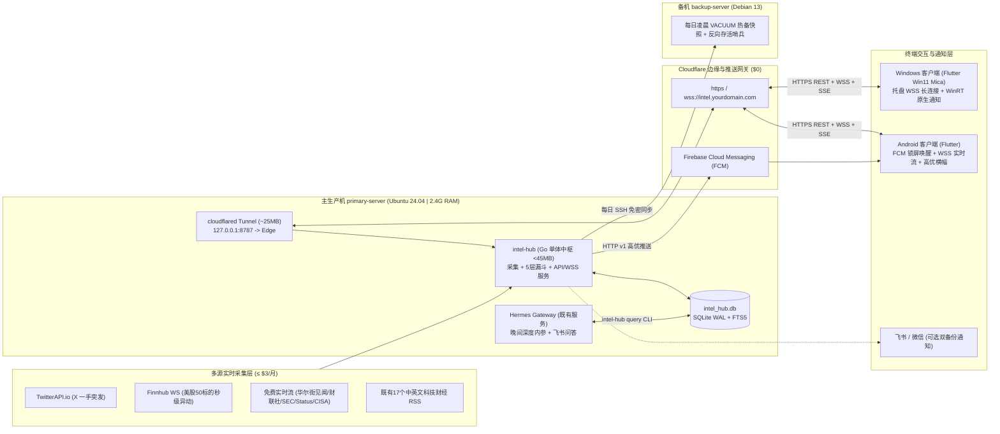

# 全天候多领域突发情报平台（Go + SQLite + 双端原生客户端 + Hermes 协同）工程实施方案 v3.0

> **版本定位**：全栈端到端工程执行规范 —— **Golang + Pure-Go SQLite 服务端中枢（部署于 `primary-server`） + Cloudflare 零端口暴露网关 + Windows & Android 现代化原生通知客户端 + Hermes 深度协同**。
> **月度运营总预算**：API 消费严格控制在 **≤ $3.00 / 月**（预计 **$1.20 ～ $2.50 / 月**，内置账本硬熔断）；Cloudflare 网关与 FCM 推送均为 **$0 / 月**（仅需自备一个廉价域名）。

---

## 一、 核心架构演进与客户端技术栈选型决策

在引入 **自研 Windows + Android 客户端（查询 + 原生系统通知）** 与 **自定义域名（Cloudflare）** 后，整套系统升级为完整的私人专业级实时情报终端（类似轻量私人版 Bloomberg Terminal / Linear 风格快讯台）。

### 1. 客户端技术栈对比与最终推荐

本地开发机实测已同时安装 **`Flutter 3.50.0 (Dart 3.14)`** 与 **`.NET SDK 10.0`**。针对 Windows + Android 双端需求，对比三种主流路线如下：

| 维度 | **方案 A（强烈首推）：Flutter 3.50 一套工程双端直出**<br>*(Windows 原生 C++ 桌面端 + Android 移动端)* | 方案 B（原生双栈备选）：Windows `WinUI 3` + Android `Flutter` | 方案 C：`Tauri v2` (Web 技术栈双端) |
| :--- | :--- | :--- | :--- |
| **研发与迭代成本** | **极高效率（1 套核心代码）**：100% 共享数据模型、WebSocket 增量同步、SQLite 本地离线缓存、搜索逻辑与 UI 组件库 | **双倍维护成本（2 套独立工程）**：每次新增字段或交互（如异动图表、核验徽章、AI 追问）需用 C#/XAML 与 Dart 各写一遍 | 桌面快，但移动端后台与推送插件生态较弱 |
| **Windows 现代化质感** | 编译为原生 Win32/DirectX 机器码；接入 `flutter_acrylic` + `window_manager` 直接启用 **Win11 原生 Mica（云母）/ Acrylic 毛玻璃材质**、无边框沉浸标题栏、全局唤醒热键 | 100% 微软官方 Fluent XAML 原生控件质感，系统集成度最纯粹 | 依赖 WebView2，多窗口与常驻内存略高于原生 |
| **Windows 原生通知与常驻** | `local_notifier` / `windows_notification` 调起 **WinRT 原生系统 Toast 弹窗**（支持分级音效、点击直达事件详情、通知中心留存）+ `tray_manager` **系统托盘后台常驻** | 原生 `AppNotificationManager` + Win32 托盘，能力一致 | 支持基础通知，复杂交互动作需额外写 Rust 桥接 |
| **Android 原生通知与保活** | **最成熟生态**：`firebase_messaging` (FCM 系统级休眠唤醒) + `flutter_local_notifications`（高优 Heads-Up 横幅、独立红警通知通道、自定义震动/铃声）+ 可选前台守护服务 | Android 端同左 | Android 端后台休眠唤醒与通知通道精细控制不成熟 |
| **选型结论** | **首选路线**：用一套高定深色毛玻璃 Bento 设计语言（Linear / Raycast 风格）同时交付 **Windows `.msix`/便携版** 与 **Android `.apk` (arm64)** | 仅在执着于纯正微软 XAML 控件体系且愿承担双倍代码维护时选用（后端 API 完全解耦，随时兼容） | 不推荐用于强依赖移动端锁屏秒级通知的场景 |

### 2. 为什么强烈建议接入「自定义域名 + Cloudflare」？
你提到可以申请域名并托管到 Cloudflare，这对双端 App 是**决定性的体验与安全升级**：
1. **彻底解决移动端 TLS 与明文限制**：Android 9+ 默认拦截明文 `http://` / `ws://`，裸 IP 自签证书会导致移动端网络库、图片加载与通知跳转频繁报错；绑定域名后天然获得合法的 **`https://` 与 `wss://` (TLS 1.3)**。
2. **`primary-server` 公网零端口暴露（Cloudflare Tunnel）**：在 `primary-server` 以普通用户运行极轻量的 `cloudflared`（仅占 ~25 MB 内存），`intel-hub` 仅监听本机回环 `127.0.0.1:8787`。无需 `sudo` 开防火墙端口、完全隐藏 ` ` 真实源站 IP，免费获得 Cloudflare 全球边缘加速、HTTP/2、WebSocket 代理与防爆破 WAF。
3. **跨网抗抖动**：国内移动网络/宽带访问 Cloudflare 边缘域名通常比裸连海外机房单点 IP 更稳，重连速度更快。

---

## 二、 全栈系统拓扑与双机资源规划



### 服务器实测内存与角色核算

| 节点别名 | 实测配置与现状 | 部署组件 | 新增内存开销 | 总内存水位评估 |
| :--- | :--- | :--- | :--- | :--- |
| **`primary-server`**<br>(` `) | Ubuntu 24.04.5 / 2.4 GiB RAM / 20G 空闲磁盘<br>`hermes-gateway.service` 常驻约 588 MB | `intel-hub.service`（采集+API+WSS）<br>`cloudflared.service`（零暴露隧道）<br>`intel_hub.db`（SQLite WAL） | `intel-hub`: ~35 MB<br>`cloudflared`: ~25 MB<br>**合计仅 ~60 MB** | 整机常驻约 1.02 GiB / 2.4 GiB，剩余 **>1.3 GiB 安全余量**，彻底告别 OOM |
| **`backup-server`**<br>(` `) | Debian 13 / 1.9 GiB RAM / 15G 空闲磁盘 | 接收每日 SQLite 快照 + `cron` 每 5 分钟探测 `https://intel.<domain>/api/v1/health` | **~0 MB 常驻** | 从公网真实用户视角端到端监控域名、隧道与 `intel-hub` 存活 |

---

## 三、 突发信源矩阵与 ≤ $3/月 API 预算硬熔断方案

### 1. API 预算精算表（月总计 `$1.20 ～ $2.60`，代码级硬熔断 `$2.80`）

| 通道/API 名称 | 核心价值 | 计费规则 | 省钱调用策略 | 预计月成本 |
| :--- | :--- | :--- | :--- | :--- |
| **1. TwitterAPI.io**<br>*(主力付费刀刃)* | 捕获比媒体快 10～30 分钟的 **X 一手突发**（OpenAI / Anthropic / DeepSeek 官方、Sam Altman / Musk、海外金融快讯号等 ~25 个核心源） | `$1 = 100,000 credits`<br>`$0.00015`/条推文（单次请求保底扣 15 credits） | 将关注账号合并为 1～2 条 `from:a OR from:b ... since_id:<id>` 增量查询；活跃时段（14h）2 分钟/次，静默时段（10h）5 分钟/次 | **`$1.20 ～ $2.20`**<br>*(单通道上限 `$2.50`)* |
| **2. Finnhub API**<br>*(Free Tier)* | **美股秒级盯盘 + 财经突发**：WebSocket 实时监听 MAG7、核心 AI 芯片股与大盘 ETF（≤50 标的）5m/15m 急涨急跌；REST 拉取市场/并购新闻 | **免费**（50 标的 WS 实时流 + 60 calls/min REST） | WS 单连接常驻内存计算滑动窗口涨跌幅；REST 每 2 分钟 1 次 | **`$0.00`** |
| **3. Brave Search / Tavily**<br>*(免费赠金/免费档)* | **股价异动自动归因 & 9+ 分重磅防假新闻多源核验** | Brave 每月赠 `$5`（1,000 次检索）；Tavily 免费 1,000 credits/月 | **仅事件驱动触发**（当个股瞬时异动 `>=3.5%` 查原因，或 `score>=9` 核查权威通讯社确认），月均 < 400 次 | **`$0.00`** |
| **4. OpenCode-Go 模型**<br>*(复用本机既有密钥)* | 第 4 层轻量 AI 裁判打分（`deepseek-v4.1-flash` / `qwen3.8-flash`）+ App 内用户主动点击「AI 深度追问」 | 复用 `primary-server:~/.hermes/.env` 既有 `OPENCODE_GO_API_KEY` | 硬规则先拦截 85%+ 噪音，日均仅 80～150 条过初筛（单条 ~430 tokens） | **`$0.00 ～ $0.40`** |
| **5. Firebase FCM + Cloudflare** | Android 系统级锁屏唤醒推送 + 全球 HTTPS/WSS 隧道网关 | 官方永久免费服务 | 按 `P1` 事件触发推送 | **`$0.00`** |

### 2. 四大目标领域完整采集源清单
* **`finance`（金融/美股异动）**：Finnhub WebSocket（`NVDA, AAPL, MSFT, GOOGL, META, AMZN, TSLA, TSM, AVGO, AMD, ASML, ARM, PLTR, QQQ, SPY, SOXX` 瞬时涨跌监控）、TwitterAPI.io 财经快讯流、华尔街见闻 7×24 快讯接口、财联社电报流、SEC EDGAR 8-K 重大披露 Atom、CNBC / WSJ Markets / 36氪 / 钛媒体 / 虎嗅。
* **`ai`（AI 行业快讯）**：TwitterAPI.io AI 实验室与掌门人流、`status.openai.com` / `status.anthropic.com` 宕机监控、GitHub Releases（`deepseek-ai`, `QwenLM`, `vllm`, `ollama`, `llama.cpp`）、官方 Blog RSS、量子位、雷锋网、Hacker News。
* **`bigtech`（大厂突发新闻）**：TwitterAPI.io 科技爆料流、Finnhub Merger/Company News、The Verge、Ars Technica、The Register、IT之家、Solidot、极客公园、爱范儿、InfoQ、开源中国。
* **`world`（全球重大突发）**：TwitterAPI.io 国际通讯社 Breaking 流、Cloudflare / GitHub / AWS Status Atom（全球网络瘫痪秒级感知）、CISA KEV（国家级在野利用零日漏洞 JSON）、USGS `M >= 6.0` 强震 Atom、BBC World / BBC 中文（自动繁转简）/ WSJ World。

---

## 四、 全量 SQLite 统一存储 Schema（含 App 设备与追问同步表）

数据库位于 `primary-server:$HOME/.hermes/intel/intel_hub.db`，采用**单写连接池（`MaxOpenConns=1`）+ 并发读连接池（`MaxOpenConns=4`）**，开启 `WAL + NORMAL + busy_timeout=5000 + FTS5`。

```sql
-- 1. 去重指纹注册表（精确 ID + 64-bit SimHash 四分段抽屉索引拦截洗稿，保留 7 天）
CREATE TABLE IF NOT EXISTS dedup_fingerprints (
    id              INTEGER PRIMARY KEY AUTOINCREMENT,
    source_uid      TEXT NOT NULL UNIQUE,   -- sha256(source_name + ":" + external_id_or_url)
    url_hash        TEXT NOT NULL,
    simhash         INTEGER NOT NULL,       -- 64-bit 语义指纹（海明距离 <= 3 判定为异源洗稿）
    band0           INTEGER NOT NULL,
    band1           INTEGER NOT NULL,
    band2           INTEGER NOT NULL,
    band3           INTEGER NOT NULL,
    title_preview   TEXT NOT NULL DEFAULT '',
    first_seen_at   INTEGER NOT NULL
);
CREATE INDEX IF NOT EXISTS idx_dedup_url ON dedup_fingerprints(url_hash);
CREATE INDEX IF NOT EXISTS idx_dedup_bands ON dedup_fingerprints(band0, band1, band2, band3);
CREATE INDEX IF NOT EXISTS idx_dedup_seen ON dedup_fingerprints(first_seen_at);

-- 2. 情报事件主表（永久全量归档，绝不按天数自动删除；年增量仅 ~250MB，primary-server 20G 磁盘可存数十年）
CREATE TABLE IF NOT EXISTS intel_events (
    id                  INTEGER PRIMARY KEY AUTOINCREMENT, -- 单调递增序号，同时作为客户端 WSS 增量同步游标 (seq_id)
    event_code          TEXT NOT NULL UNIQUE,   -- 如 EVT-20261125-0042
    source_name         TEXT NOT NULL,
    category            TEXT NOT NULL,          -- finance | ai | bigtech | world
    raw_title           TEXT NOT NULL,
    zh_title            TEXT NOT NULL,          -- 18 字内高信息密度中文标题
    summary             TEXT NOT NULL,          -- 清洗后核心事实摘要
    impact_analysis     TEXT NOT NULL DEFAULT '', -- AI 一句话市场/产业影响推演
    canonical_url       TEXT NOT NULL,
    entities_json       TEXT NOT NULL DEFAULT '[]', -- ["NVDA","TSM"]
    quote_snapshot_json TEXT NOT NULL DEFAULT '{}', -- 若为行情异动，附带价格、5m涨跌幅与迷你走势点阵
    score               INTEGER NOT NULL,       -- 1~10 分
    tier                TEXT NOT NULL,          -- P1_CRITICAL (9~10) | P1_HIGH (8) | P2_DIGEST (5~7) | P3_ARCHIVE (<5)
    is_bookmarked       INTEGER NOT NULL DEFAULT 0, -- 客户端收藏/星标状态（双端同步，永久置顶备查）
    user_note           TEXT NOT NULL DEFAULT '',   -- 用户个人复盘批注
    push_status         TEXT NOT NULL,          -- pushed | cooled_down | digested | silent_baseline
    verification_status TEXT NOT NULL DEFAULT 'none', -- none | pending | confirmed | unverified | contradicted
    verification_note   TEXT NOT NULL DEFAULT '',
    search_tokens       TEXT NOT NULL DEFAULT '',   -- 预生成的 CJK 二元切分 + 英文词根归一化索引串，彻底解决 SQLite 默认分词器搜不准中文子串的痛点
    published_at        INTEGER NOT NULL,
    created_at          INTEGER NOT NULL,
    updated_at          INTEGER NOT NULL
);
CREATE INDEX IF NOT EXISTS idx_events_created ON intel_events(created_at DESC);
CREATE INDEX IF NOT EXISTS idx_events_published ON intel_events(published_at DESC);
CREATE INDEX IF NOT EXISTS idx_events_cat_score_time ON intel_events(category, score DESC, published_at DESC);
CREATE INDEX IF NOT EXISTS idx_events_bookmarked ON intel_events(is_bookmarked, published_at DESC) WHERE is_bookmarked = 1;

-- 实体倒排映射表（支撑点击 #NVDA / #OpenAI 毫秒级拉出跨月/跨年「单一实体完整历史演进时间轴」）
CREATE TABLE IF NOT EXISTS event_entities (
    entity_norm     TEXT NOT NULL,          -- 归一化实体名，如 "NVDA", "OPENAI", "美联储"
    event_id        INTEGER NOT NULL REFERENCES intel_events(id) ON DELETE CASCADE,
    published_at    INTEGER NOT NULL,
    score           INTEGER NOT NULL,
    PRIMARY KEY (entity_norm, event_id)
);
CREATE INDEX IF NOT EXISTS idx_entity_timeline ON event_entities(entity_norm, published_at DESC);

-- 全文检索虚拟表（配合 search_tokens + BM25 权重排序，中英文历史词条毫秒级召回并高亮 snippet）
CREATE VIRTUAL TABLE IF NOT EXISTS intel_events_fts USING fts5(
    event_code, zh_title, raw_title, summary, impact_analysis, entities_json, search_tokens,
    content='intel_events', content_rowid='id',
    tokenize='unicode61 remove_diacritics 2'
);

-- 3. 每日内参日报归档表（存储每日 21:00 Hermes 生成的结构化晚报，供 App「内参」页阅读）
CREATE TABLE IF NOT EXISTS daily_digests (
    id              INTEGER PRIMARY KEY AUTOINCREMENT,
    digest_date     TEXT NOT NULL UNIQUE,   -- "2026-11-25" (UTC+8)
    title           TEXT NOT NULL,
    content_md      TEXT NOT NULL,          -- 结构化 Markdown 正文
    event_count     INTEGER NOT NULL DEFAULT 0,
    created_at      INTEGER NOT NULL
);

-- 4. 事件内嵌 AI 深度追问记录表（实现 Windows 与 Android 双端问答历史同步）
CREATE TABLE IF NOT EXISTS event_threads (
    id              INTEGER PRIMARY KEY AUTOINCREMENT,
    event_id        INTEGER NOT NULL REFERENCES intel_events(id) ON DELETE CASCADE,
    role            TEXT NOT NULL,          -- user | assistant
    content_md      TEXT NOT NULL,
    model_used      TEXT NOT NULL DEFAULT '',
    created_at      INTEGER NOT NULL
);
CREATE INDEX IF NOT EXISTS idx_threads_event ON event_threads(event_id, created_at ASC);

-- 5. 客户端设备与个性化推送订阅表（支持手机和电脑设置不同打扰阈值）
CREATE TABLE IF NOT EXISTS client_devices (
    device_id       TEXT PRIMARY KEY,       -- 客户端生成的 UUID
    device_name     TEXT NOT NULL,          -- 如 "Win11-Workstation" / "Android-Pixel"
    platform        TEXT NOT NULL,          -- windows | android
    fcm_token       TEXT NOT NULL DEFAULT '', -- Android FCM 令牌
    min_push_score  INTEGER NOT NULL DEFAULT 8, -- 例如：手机设 >=8 才响铃，桌面端设 >=7 弹托盘通知
    categories_json TEXT NOT NULL DEFAULT '["finance","ai","bigtech","world"]',
    quiet_hours     TEXT NOT NULL DEFAULT '', -- 可选免打扰时段如 "01:00-07:30"（9~10分特大突发可配置突破）
    last_seen_at    INTEGER NOT NULL,
    created_at      INTEGER NOT NULL
);

-- 6. 次级情报待汇总队列、7. 同主题 30 分钟冷却锁、8. 信源游标健康表、9. API 预算熔断账本
-- （结构同核心流水线设计：digest_queue / cooldown_locks / source_states / api_budget_ledger）
```

---

## 五、 服务端 API 与实时推送协议规范（实时流 + 全量历史检索）

所有接口挂载于 `https://intel.<your-domain>/api/v1`，采用 **`Authorization: Bearer <APP_API_TOKEN>`** 鉴权（客户端首次打开支持**粘贴配对串或扫码一键绑定域名与密钥**）。

### 1. 核心 HTTP / SSE / WebSocket 端点清单

| 方法与路径 | 协议类型 | 功能说明与交互细节 |
| :--- | :--- | :--- |
| `GET /api/v1/health` | HTTP JSON | 免鉴权存活探针（仅返回 `{"ok":true,"ts":...}`，供 Cloudflare 与 `backup-server` 哨兵监控） |
| `GET /api/v1/events` | HTTP JSON | 实时/历史游标分页浏览：支持 `categories`, `min_score`, `max_score`, `from_ts`, `to_ts`, `bookmarked_only`, `before_id`, `after_id`, `limit` |
| `GET /api/v1/events/search` | HTTP JSON | **全量历史多维复合检索**：基于 CJK 增强版 SQLite FTS5 + BM25 权重排序，支持关键词 `q`（股票代码/公司/人物/事件短语）叠加**任意起止日期区间 (`from_ts`~`to_ts`)、领域多选、分数段、信源、排序方式 (`relevance`/`time_desc`/`time_asc`/`score_desc`)**，返回匹配高亮片段 (`snippet`)，十万级历史数据响应 `< 15ms` |
| `GET /api/v1/entities/{name}/timeline` | HTTP JSON | **单一实体历史演进时间轴**：如传入 `NVDA`、`OpenAI` 或 `美联储`，按时间脉络拉出跨月/跨年的全部历史关联突发事件与评分轨迹 |
| `GET /api/v1/events/{code}` | HTTP JSON | 获取单条事件完整详情、行情异动快照、多源核验说明、同实体近期关联历史事件及追问对话列表 |
| `PATCH /api/v1/events/{code}/bookmark` | HTTP JSON | 收藏/取消星标该历史事件或添加个人复盘批注 (`user_note`)，Windows 与 Android 双端实时同步 |
| `POST /api/v1/events/{code}/ask` | **HTTP SSE** | **单事件 AI 深度溯源**：提交追问，服务端自动带入事件上下文 + 按需联网搜索，以 **SSE 流式吐字**返回并存入 `event_threads` |
| `POST /api/v1/history/ask` | **HTTP SSE** | **跨周期历史复盘 AI 问答（Historical RAG）**：例如问 *“梳理过去半年 OpenAI 与 DeepSeek 的发布与价格战脉络”*，后端先从本地 `intel_events` 全量历史库召回高相关历史记录喂给强模型，生成带 `[#EVT-...]` 可点击引用溯源的复盘报告 |
| `GET /api/v1/digests` | HTTP JSON | **历史内参日历归档**：支持按月份 (`month=2026-11`) 返回日历打点状态，或按具体日期调阅任意历史某天的《今日情报内参》及当日关联原始事件 |
| `POST /api/v1/devices/sync` | HTTP JSON | 注册/更新设备信息、Android `fcm_token`、单设备推送分数阈值与免打扰规则 |
| `GET /api/v1/system/overview` | HTTP JSON | 返回 20+ 信源健康绿灯状态、历史归档总条数/库体积、以及当月 `$3` 预算实时账单 |
| `GET /api/v1/stream?after_id={seq}` | **WebSocket (`wss://`)** | **毫秒级实时事件总线**：① 连接建立立即补推 `id > after_id` 的离线漏接事件；② 实时推送 `event.created`、`event.verified` 与 `event.bookmarked` 同步帧 |

---

## 六、 Windows & Android 现代化客户端 UI/UX、历史检索与原生通知设计

### 1. 视觉与交互规范（现代暗黑情报终端美学）
* **配色与材质**：默认采用深邃石板黑底色（`#0B0F17`）搭配微边框毛玻璃卡片；按严重度使用高辨识度语义色：**`9~10 分` 绯红脉冲徽章（Critical）**、**`8 分` 琥珀橙徽章（High）**、**`5~7 分` 电光蓝/青灰徽章（Digest）**。
* **自适应响应式骨架**：
  * **Windows 桌面端（三栏式 Master-Detail 专业工作台）**：
    * 开启 **Windows 11 原生 Mica 云母材质**与自定义无边框标题栏；
    * **左栏（窄导航）**：实时流 / **历史检索库（Archive）** / 收藏批注夹 / 每日内参日历 / 信源与预算仪表盘；
    * **中栏（快讯流与高级筛选器）**：顶部常驻 `Ctrl+K` 全局历史搜索栏 + 快捷时间胶囊（24h / 7d / 30d / 自定义历史日期选择器）+ 分数段滑块，实时插入新卡片带柔和滑入高亮动效；
    * **右栏（沉浸详情、实体时间轴与 AI 面板）**：展示事件摘要、影响推演、多源核验徽章、**同实体历史回溯小卡片（点击 `#NVDA` 一键展开过往全部大事件时间轴）**，底部常驻 **「AI 情报官追问 / 历史复盘」流式对话框**。
    * **桌面专属效率特性**：关闭窗口自动缩入**系统托盘常驻**；支持全局快捷键（如 `Alt+I`）随时呼出主窗口秒查历史。
  * **Android 移动端（单手友好 Bento 流）**：
    * 底部四 Tab（`实时`、`历史库`、`内参日历`、`设置`）；卡片左滑一键星标收藏或记复盘笔记，点击实体标签弹出历史演进时间线，支持 Material You 动态取色与 OLED 纯黑模式。

### 2. 全量历史查询专项体验设计（快、准、可复盘）
1. **永久归档 + 本地/云端二级透明查询**：
   * 服务端 `intel_events` **永久保留全量历史数据**（年增长仅 ~250 MB，`primary-server` 现有 20 GB 空闲空间可轻松容纳数十年全量历史，绝不删库）；上线时顺带支持将 `primary-server` 现有 `~/.hermes/cron/output/` 中的历史快讯记录一并回填导入。
   * 客户端本地 `drift` SQLite 缓存近期热数据与**全部个人收藏/批注事件（断网永久可查）**；当搜索远期历史或跨月筛选时，无缝调用远端 FTS5 接口并渲染关键词高亮摘要。
2. **中英文混合精准分词检索**：针对 SQLite 原生 `unicode61` 分词器对中文长句切分不准的痛点，Go 入库时自动生成 **CJK 二元切分 + 英文/代码词根索引 (`search_tokens`)**，搜 `台积电 涨价`、`NVDA subpoena` 或 `#EVT-20261125` 均毫秒级精准召回。
3. **三种历史复盘视角切换**：
   * **列表高亮模式**：按相关度（BM25）或严重度最高看历史大事件；
   * **演进时间轴模式（正序/倒序）**：点选某家公司/标的或自定义起止日期，按时间脉络复盘事件发酵全过程；
   * **日历内参模式**：在日历组件点选过去任意一天，直接阅读当晚的《今日情报内参》及当天原始事件快照。

### 3. 双端原生系统通知深度集成（确保“锁屏必达、绝不漏报”）
* **Windows 原生通知（WinRT Toast Notification）**：
  * 托盘后台维持 `wss://` 极低开销长连接；收到达标突发事件立即调用 Windows 原生通知 API 弹出系统右下角卡片：
    * 标题：`🔴 [9/10 金融突发] 英伟达盘后急跌6%：收到反垄断传票`
    * 正文：AI 提炼的一句话核心影响推演
    * 交互按钮：`[深度分析]`（点击唤醒主窗口并直接打开该事件详情页） | `[查看原文]`（浏览器直开原链接）
* **Android 原生通知（FCM 系统唤醒 + WSS + 分级通知通道）**：
  * 注册 3 个独立的 **Android 原生 Notification Channels**（用户可在系统设置精细管控）：
    1. `🔴 特急突发红警 (Score 9-10)`：`Importance.MAX`，锁屏横幅弹出（Heads-Up）、专属紧急提示音、可申请开启“突破免打扰（Override DND）”；
    2. `🟠 重要突发快讯 (Score 8)`：`Importance.HIGH`，标准横幅与提示音；
    3. `📘 每日情报内参`：`Importance.DEFAULT`，晚间 21:00 温和提醒阅读日报。
  * **双通道送达保障**：App 在前台时由 `wss://` 毫秒级直推；App 退至后台或锁屏休眠时，由 `primary-server` 服务端调用 **Google FCM 高优通道** 系统级唤醒；同时针对无 Google Play 服务或开盘重度盯盘场景，在 App 设置页提供可选的 **「常驻盯盘守护模式（低功耗前台通知栏）」** 开关，确保任何国产 ROM 下都能秒级直达。

---

## 七、 Monorepo 仓库结构与免密部署全流程

### 1. 项目目录结构（`<PROJECT_ROOT>`）

```text
InformationPlatform/
├── server/                          # Golang + SQLite 服务端中枢 (编译为单一 intel-hub 二进制)
│   ├── cmd/intel-hub/main.go        # serve | query | migrate-hermes | backup | budget | pair-qrcode
│   ├── internal/
│   │   ├── config/                  # YAML 配置与环境变量加载
│   │   ├── store/                   # modernc.org/sqlite 双池封装、DDL 迁移、CJK-FTS5 检索、VACUUM 热备
│   │   ├── collector/               # RSS / 华尔街见闻&财联社 / TwitterAPI.io / Finnhub WS / SEC / Status
│   │   ├── pipeline/                # L1 净化繁转简 -> L2 SimHash 去重 -> L3 规则 -> L4 打分 -> L5 核验
│   │   ├── api/                     # HTTP REST + 多维历史搜索 + 实体时间轴 + WSS 实时流 + SSE 历史复盘问答
│   │   └── notifier/                # FCM HTTP v1 推送 + 飞书卡片 + 微信 <=120 字精简同步
│   └── go.mod
├── client/                          # Flutter 3.50 现代化双端客户端 (Windows + Android)
│   ├── lib/
│   │   ├── core/                    # API 客户端、WSS 自动重连与游标补推、Drift 本地热缓存与收藏库
│   │   ├── features/
│   │   │   ├── feed/                # 实时情报流、快捷过滤胶囊
│   │   │   ├── archive_search/      # 全量历史多维搜索、任意日期区间选择、单一实体演进时间轴、收藏批注夹
│   │   │   ├── detail_ai/           # 事件详情、异动火花线、单事件追问与跨周期历史复盘 RAG 抽屉
│   │   │   ├── digest/              # 历史日历选择器 + 每日 21:00 内参归档阅读器
│   │   │   └── settings/            # 扫码配对、单设备推送阈值、信源健康灯与 $3 预算进度条
│   │   └── platform/                # Windows (Mica/托盘/WinRT Toast/热键) & Android (FCM/通知通道) 适配层
│   ├── windows/                     # Win32/C++ 原生宿主配置
│   ├── android/                     # Android 原生宿主与通知权限配置
│   └── pubspec.yaml
├── configs/
│   ├── config.example.yaml
│   └── hermes-skill/SKILL.md        # 挂载到 primary-server:~/.hermes/skills/intel-hub/SKILL.md
├── deploy/
│   ├── intel-hub.service            # systemd --user 服务单元 (MemoryMax=128M)
│   ├── cloudflared.service          # systemd --user Cloudflare Tunnel 零端口暴露单元
│   ├── sentinel-check.sh            # 部署于 backup-server 的端到端 HTTPS 健康探针与容灾脚本
│   └── deploy-all.ps1               # 本地一键编译 Go 后端发布 primary-server + 打包 Windows/Android 客户端
└── hermes.md
```

### 2. Cloudflare 与域名接入极简清单（仅需 5 分钟）
1. 将新申请的域名 NS 托管至 Cloudflare（Free 计划）。
2. 在 Cloudflare Zero Trust $\rightarrow$ Networks $\rightarrow$ Tunnels 创建一个名为 `intel-hub-tunnel` 的 Tunnel，获取一行 `TUNNEL_TOKEN`，并将公网主机名 `intel.<你的域名>` 指向 `http://127.0.0.1:8787`（Cloudflare 会自动在 DNS 生成加密 CNAME 记录并签发边缘证书，原生支持 HTTPS 与 WSS）。
3. 将 `TUNNEL_TOKEN` 填入 `primary-server` 的 `~/.hermes/intel/.env`，由部署脚本启动 `cloudflared.service` 即可立刻跑通全球加密访问。

---

## 八、 分阶段研发与交付里程碑（M1 ～ M5）

| 阶段 | 交付模块 | 验收标准（Acceptance Criteria） |
| :--- | :--- | :--- |
| **M1：Go 核心引擎与存量平滑迁移** | 完成 `server/` 存储层（SQLite WAL + FTS5）、五层过滤流水线（含 64-bit SimHash 洗稿拦截）、免费高频采集源与 `migrate-hermes` 历史水位导入。 | 单元测试全通过；交叉编译部署至 `primary-server` 导入既有 17 源水位，首次运行 **0 旧闻误报**，内存 `< 40MB`。 |
| **M2：低成本突发 API、AI 裁判与网关上线** | 接入 `TwitterAPI.io`、`Finnhub WS`、`Brave/Tavily` 归因核验、`$2.80` 预算熔断账本；开放 REST + WSS + SSE 接口并通过 `cloudflared` 绑定域名上线；打通同机 Hermes Skill 与 21:00 日报写库。 | 通过 `https://intel.<domain>/api/v1/health` 公网验证连通；`WSS` 实时流正常吐出评分数据；Hermes 晚报自动落库 `daily_digests`。 |
| **M3：Windows 现代桌面客户端交付** | 基于本地 `Flutter 3.50` 完成三栏式 Mica 毛玻璃桌面端、实时流、全文搜索、AI 流式追问面板、系统托盘常驻、全局呼出热键与 **WinRT 原生 Toast 通知**。 | Windows 端最小化到托盘后，服务端模拟触发一条 `9/10` 突发，桌面右下角 **1 秒内弹出原生通知**，点击直接唤醒定位到该事件详情。 |
| **M4：Android 客户端与锁屏推送交付** | 完成 Android 端自适应 UI、三级原生 Notification Channels、FCM 服务端联动下发与可选后台守护模式，打包签名版 `arm64-v8a` APK。 | 手机锁屏息屏状态下触发 `P1` 突发，手机秒级亮屏弹出高优横幅通知；点开后与 Windows 端实时同步 AI 追问记录。 |
| **M5：`backup-server` 异地备份与外部哨兵收尾** | 开启每日凌晨 `VACUUM INTO` 热备免密同步至 `backup-server`，并在 `backup-server` 启用每 5 分钟端到端域名健康巡检与飞书运维告警。 | 备机收到首份一致性 `.db` 快照；模拟停止主服务时备机成功发出告警。 |

---

## 九、 开工前准备事项（随时可启动 M1 编码）

服务端与客户端代码无需等待域名或 API Key 即可**立刻在本地开始编写和联调**。在你方便时只需陆续准备：
1. **域名与 Cloudflare**：注册任意后缀域名加入 Cloudflare，后续到 **M2 部署阶段** 配一条 Tunnel 指向 `127.0.0.1:8787` 即可。
2. **低成本 / 免费密钥**（届时直接填入 `primary-server` 环境变量即可）：
   * `TWITTERAPI_IO_KEY`（按量付费，充 `$5` 够用两三个月）
   * `FINNHUB_API_KEY` + `BRAVE_API_KEY` 或 `TAVILY_API_KEY`（均免费申请）
   * **Firebase 项目配置**（如需要 Android 锁屏省电系统级推送，在 Firebase Console 免费建一个空项目导出 `google-services.json` 与服务端 Service Account JSON 即可；若纯走自建 WebSocket 常驻保活甚至连 Firebase 都可省去）。
